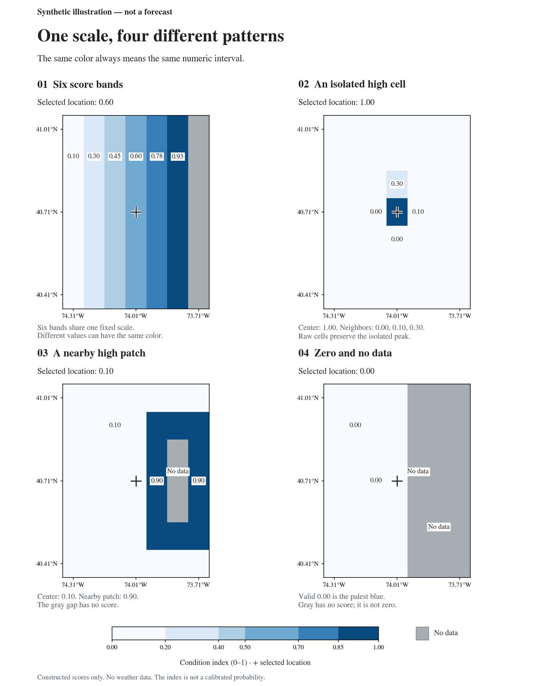

# Firecloud Forecast

**Sunrise and sunset glow forecasts from cloud layers and the path of sunlight.**

[](https://github.com/NickZhuxy/firecloud-forecast/actions/workflows/tests.yml)
[](LICENSE)

Firecloud gives a condition index from 0 to 1 for a sunrise or a sunset.
The index tells how well the forecast atmosphere matches the conditions for a
colored sky. It is not a probability.

Coverage: national and local maps for China, and local maps for New York City.



*Synthetic examples of the index colors.
[Read the four cases and the color scale](examples/color-guide/README.md).*

## How it works

Cloud cover alone does not decide if clouds glow. An overcast sky often stays
gray, and a few high clouds can glow brightly. Firecloud asks two questions.

### Is there a cloud layer that can catch the light?

After sunset, the sun is below your horizon, but it still lights clouds that
are high enough. Firecloud reads the Global Forecast System (GFS) profile above
the point. It finds each cloud layer and its base, top, phase and opacity. Then
it selects the layer that can act as the canvas.

### Can sunlight reach that layer?

Light reaches the canvas at a grazing angle, from the direction of the sun.
Firecloud builds a path toward the sun, out to 800 km. It reads a GFS column
every 25 km along that path. Then it traces the ray to the base of the canvas.
A low cloud deck, terrain or dense aerosol on the path can block the ray.

### How the conditions combine

Some conditions are necessary. Firecloud calls them gates:

- mid or high cloud is present,
- low cloud does not cover the view,
- the sun is at a usable angle,
- sunlight can reach the canvas.

Other conditions change the quality. Firecloud calls them modifiers: humidity,
clean air, cloud altitude, cloud amount and boundary confidence.

```text
gate     = weighted geometric mean of the gate scores
modifier = weighted arithmetic mean of the modifier scores
index    = gate × modifier
```

If one gate is zero, the index is zero. Good modifiers cannot make up for a
missing canvas or a blocked path.

The national map uses a faster version without the 800 km ray trace. It then
traces rays again for the most promising areas. The local map runs the full
calculation at each grid cell. [Methodology](research/methodology.md) gives each
rule and its weight.

## Quick start

To see the forecast without an installation, open the
[map](https://nickzhuxy.github.io/firecloud-forecast/). Select a product, a date,
and an event. Click a cell to read its values.

To run the forecast on your computer, do the steps that follow.

Prerequisites: Python 3.11 or newer and [uv](https://docs.astral.sh/uv/).

1. Get the code and install it:

   ```bash
   git clone https://github.com/NickZhuxy/firecloud-forecast.git
   cd firecloud-forecast
   uv sync --frozen
   ```

2. Get the published national sunset map:

   ```bash
   uv run firecloud --source remote --event sunset
   ```

3. Get a local map for one point. Give the latitude and longitude:

   ```bash
   uv run firecloud --event sunset --lat 31.23 --lon 121.47
   ```

   With coordinates, the command makes only the local maps.
   Add `--scope all` to also make the national maps.

4. For New York City, add the region:

   ```bash
   uv run firecloud --region us-nyc --source local --event sunset \
     --lat 40.7128 --lon -74.0060
   ```

   The New York pilot accepts centers from 40.0 to 41.5°N and 75.0 to 72.5°W.
   It uses the New York calendar date. See [the pilot limits](docs/usage.md#new-york-city-pilot).

To check an archived forecast without a download, run
`python examples/shanghai-sunset/verify.py`.

On macOS, if GRIB or map libraries are missing, install `eccodes`, `geos` and
`proj` with Homebrew. See [usage and troubleshooting](docs/usage.md).

## Run time

Measured on one Mac (Apple silicon) for a 150 km local map with 837 cells:

| Case | Time |
| --- | --- |
| First run for a forecast hour (downloads about 130 MB of GFS data) | about 25 s |
| GFS data already on disk | about 6 s |

Open-Meteo counts each grid cell as one location. Its free tier allows about
5,000 locations per hour, so it refuses many local maps in one hour (HTTP 429).

## Outputs

```text
output/YYYY-MM-DD/
├── national-sunrise.png
├── national-sunrise.json
├── national-sunset.png
├── national-sunset.json
└── point-31.23_121.47-sunset.png   # Plus JSON, when coordinates are supplied
```

New York City products go to `output/us-nyc/YYYY-MM-DD/`. Each JSON file records
the event time, the GFS run and forecast hour, the inputs and the algorithm
version. Gray cells on a map are missing data.
[How to read the maps](docs/scientific-figures.md) explains the scale.

## Automatic local forecasts

A Mac can make a forecast for one saved location before each sunrise or sunset.
See the [setup procedure](docs/automatic-forecasts.md).

```bash
uv run firecloud status --config .local/forecast-service/viewpoint.json --output output/forecasts
uv run firecloud preview --config .local/forecast-service/viewpoint.json --output output/forecasts
```

`status` reads saved results. `preview` requests one extra forecast.

## Limits

- GFS has 0.25° resolution. A 0.1° local grid samples the model more often,
  but it does not add detail that the model does not have.
- Cloud edges, aerosol and timing are uncertain at model resolution. The model
  does not forecast convective clouds well.
- The default local run has no terrain heights and no per-column aerosol
  depth along the path.
- Firecloud does not compute a full spectral radiative transfer. It does not
  predict sky colors.
- Some Python fields keep the old name `probability`. They hold the condition
  index.

## Documentation

| Guide | Contents |
| --- | --- |
| [Usage](docs/usage.md) | Installation, CLI options, output, troubleshooting |
| [Methodology](research/methodology.md) | Rules, thresholds, weights and scientific limits |
| [Read the maps](docs/scientific-figures.md) | Index scale, missing data, map geometry, source times |
| [Shanghai example](examples/shanghai-sunset/README.md) | A real map, its source times and an offline check |
| [New York City example](examples/new-york-sunset/README.md) | A local forecast, model times and input limits |
| [Color examples](examples/color-guide/README.md) | Score intervals, zero and missing data |
| [Automatic forecasts](docs/automatic-forecasts.md) | Scheduled local forecasts and status |
| [Optional observations](docs/observation-pilot.md) | Record what the sky did next to the forecast |
| [Architecture](docs/architecture.md) | Data flow, package map, contracts |
| [Static publishing](docs/publishing.md) | Precomputed maps on GitHub Pages |
| [Project story](docs/project-story.md) | How the design changed and why |
| [Roadmap](docs/roadmap.md) | Next steps and their checks |
| [Contributing](CONTRIBUTING.md) | Development setup, tests, pull requests |

## License and data

The code uses the [MIT License](LICENSE).
The included Inter font files use the [SIL Open Font License 1.1](predictor/assets/fonts/OFL.txt).

Weather data by [Open-Meteo.com](https://open-meteo.com/) ([CC BY 4.0](https://creativecommons.org/licenses/by/4.0/)),
alongside NOAA GFS; transformed into Firecloud's derived diagnostic.
Map context made with Natural Earth.
Weather data, maps and third-party references have their own terms; see
[data sources](docs/data-sources.md).
